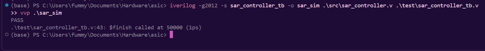

# SAR ADC

After spending a week, tryna get Wokwi to work, I switched to Verilog! Absolute frist time dealing w Verilog, but I watched some YT videos and learned what the code looks like.

I just wrote the logic that converts for the leftmost bit! and then I wrote a testbench for it! and we passed!

